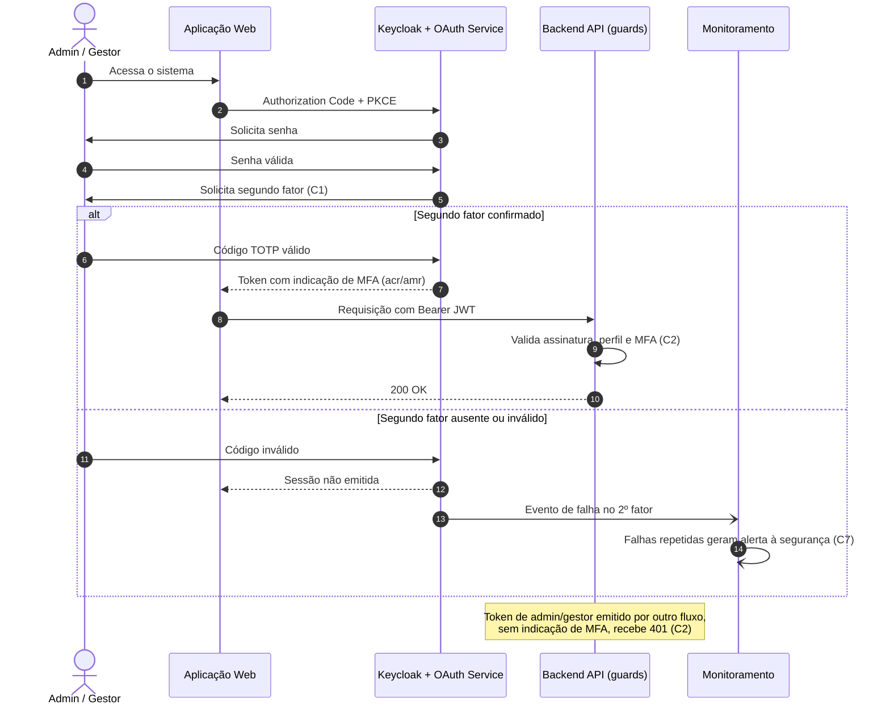
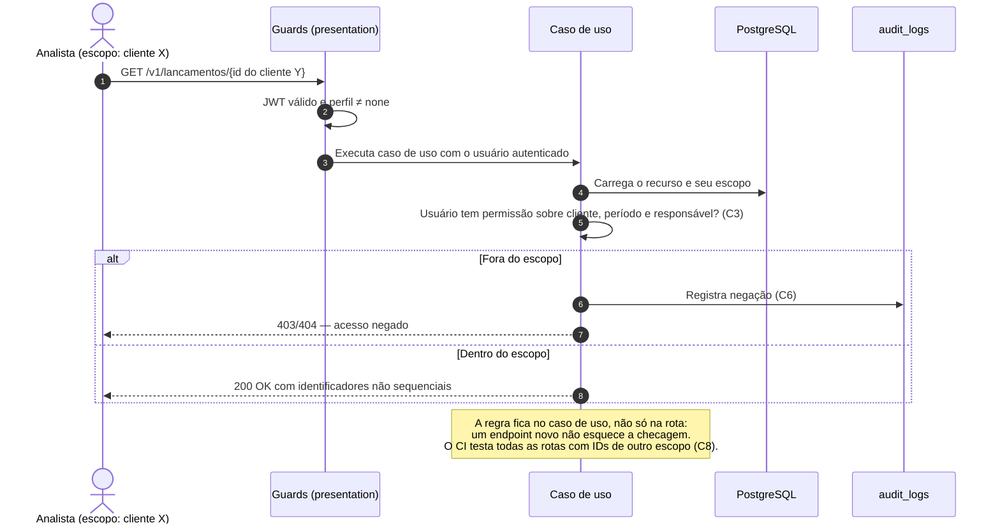
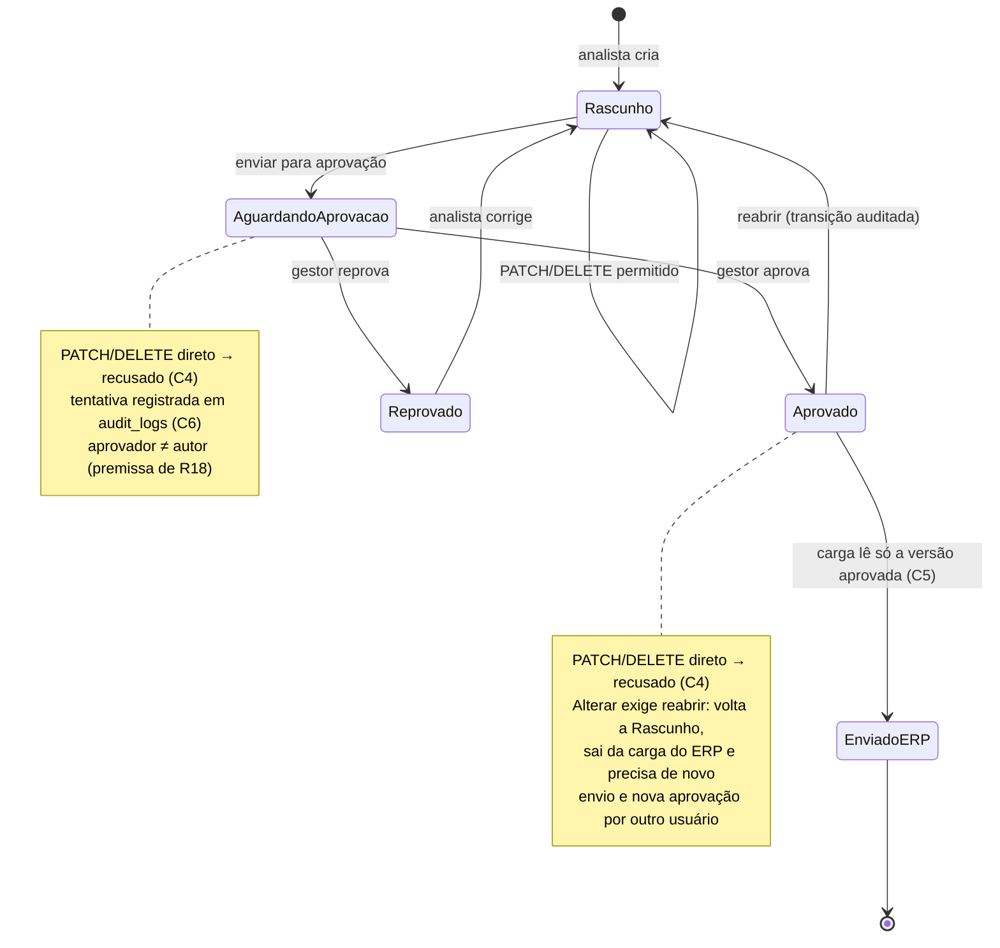

# Etapa 3 — Diagrama da arquitetura segura

Este documento mostra como usuários, aplicação, autenticação, autorização, dados e monitoramento se organizam na arquitetura proposta e **onde ficam os controles** que tratam os riscos prioritários R01, R02 e R03. Ele parte da [arquitetura geral da Etapa 1](../etapa-1/etapa-1-identificacao-sistema.md#diagrama-geral), das ameaças STRIDE [T01, T02, T03, T07 e T09](../etapa-1/etapa-1-ameacas-stride.md) e do [mapeamento NIST CSF 2.0 da Etapa 2](../etapa-2/etapa-2-nist-csf.md), e materializa os [requisitos RS01–RS03](etapa-3-requisitos.md) e as [decisões D01–D03](etapa-3-decisoes.md).

O diagrama é uma **proposta**. Os controles marcados ainda não estão implementados, e a redução de risco só se confirma com implementação, testes e evidências.

As referências cumprem papéis distintos ao longo do documento. O STRIDE classifica as ameaças (Etapa 1), o NIST CSF 2.0 organiza os controles por função e categoria (Etapa 2), e o CWE e o OWASP nomeiam as vulnerabilidades que os controles fecham ([vulnerabilidades catalogadas](etapa-3-vulnerabilidades.md)).

## 1. Visão geral da arquitetura segura

As caixas tracejadas são as **fronteiras de confiança**. Cada controle aparece com um identificador `Cn` e com o requisito e a decisão que o originam.

```mermaid
flowchart LR
    %% ---------- Fronteira 1: Consumo (não confiável) ----------
    subgraph Z1["Fronteira 1 · Consumo (não confiável)"]
        U["Usuário corporativo<br/>admin · gestor · analista · none"]
        SPA["Aplicação Web (SPA)<br/>navegador"]
    end

    %% ---------- Fronteira 2: Borda e identidade ----------
    subgraph Z2["Fronteira 2 · Borda e identidade"]
        KC["SSO · Keycloak + OAuth Service .NET<br/>OIDC + PKCE<br/><b>C1</b> MFA obrigatório p/ admin e gestor<br/>(RS02 · D01)"]
        APIM["APIM · gateway<br/>TLS · rate limit"]
    end

    %% ---------- Fronteira 3: Aplicação ----------
    subgraph Z3["Fronteira 3 · Aplicação (Backend API · FastAPI)"]
        direction TB
        G["presentation · guards (src/core/auth)<br/>valida JWT (JWKS) e perfil<br/><b>C2</b> recusa token de admin/gestor sem MFA<br/>(RS02 · D01)"]
        UC["application · casos de uso<br/><b>C3</b> autorização por recurso:<br/>cliente · período · responsável<br/>IDs não sequenciais (RS03 · D02)"]
        SM["domain · máquina de estados<br/>billing_status<br/><b>C4</b> única via de mudança após o envio<br/>PATCH/DELETE direto recusado (RS01 · D03)"]
        ERPGEN["Gerador da carga ERP<br/><b>C5</b> lê só a última versão aprovada<br/>(RS01 · D03)"]
        G --> UC --> SM
        UC --> ERPGEN
    end

    %% ---------- Fronteira 4: Dados ----------
    subgraph Z4["Fronteira 4 · Persistência"]
        PG[("PostgreSQL<br/>lançamentos · regras · perfis")]
        AUD[("audit_logs<br/><b>C6</b> usuário · recurso · operação · resultado<br/>transições e negações (RS01 · RS03)")]
        BLOB[("Blob Storage<br/>anexos via URL assinada<br/>emitida após C3")]
    end

    %% ---------- Monitoramento e verificação ----------
    subgraph Z5["Monitoramento e verificação"]
        MON["Monitoramento / alertas<br/><b>C7</b> falhas repetidas no 2º fator<br/>negações por escopo · tentativas pós-envio"]
        SEC["Equipe de segurança"]
        CI["Pipeline CI<br/><b>C8</b> suíte de testes de autorização<br/>por rota + testes da máquina de estados"]
    end

    ERP["ERP corporativo<br/>(sistema externo)"]

    U --> SPA
    SPA -- "① login OIDC + PKCE" --> KC
    KC -- "② token com indicação de MFA (acr/amr)" --> SPA
    SPA -- "③ HTTPS · Bearer JWT" --> APIM
    APIM -- "④ roteia" --> G
    UC -- "⑤ leitura/escrita autorizada" --> PG
    UC -- "anexos" --> BLOB
    SM -- "⑥ registra transição" --> AUD
    UC -- "registra negação" --> AUD
    ERPGEN -- "⑦ carga aprovada" --> ERP
    KC -. "eventos de login" .-> MON
    AUD -. "eventos" .-> MON
    MON -. "alerta" .-> SEC
    CI -. "verifica antes do deploy" .-> Z3

    classDef ctrl fill:#E8F5E9,stroke:#2E7D32,stroke-width:2px,color:#1B1B1B
    classDef ext fill:#F3F4F6,stroke:#6B7280,color:#1B1B1B
    classDef data fill:#E3F2FD,stroke:#1565C0,color:#1B1B1B
    class KC,G,UC,SM,ERPGEN,MON,CI ctrl
    class U,SPA,ERP,SEC,APIM ext
    class PG,AUD,BLOB data
    style Z1 stroke-dasharray: 6 4
    style Z2 stroke-dasharray: 6 4
    style Z3 stroke-dasharray: 6 4
    style Z4 stroke-dasharray: 6 4
    style Z5 stroke-dasharray: 6 4
```

**Leitura do fluxo principal:** o usuário autentica no SSO (①), que só emite token de administrador ou gestor depois do segundo fator. A SPA chama a API pelo APIM (③ e ④). Os guards validam o token e, nos perfis privilegiados, a indicação de MFA. O caso de uso confere se o usuário tem permissão **sobre aquele registro** antes de ler ou gravar (⑤). Qualquer mudança em lançamento já enviado para aprovação passa pela máquina de estados: o lançamento aprovado é reaberto para `Rascunho`, sai da carga do ERP e precisa de novo envio e nova aprovação, e a transição fica gravada em `audit_logs` (⑥). O ERP recebe apenas a versão aprovada (⑦).

## 2. Controles posicionados no diagrama

| Controle | Onde fica                                       | O que faz                                                                                                                   | Requisito | Decisão | Risco | Ameaça STRIDE (Etapa 1)        | NIST CSF 2.0 (Etapa 2) |
| :------: | ----------------------------------------------- | --------------------------------------------------------------------------------------------------------------------------- | :-------: | :-----: | :---: | ------------------------------ | ---------------------- |
|    C1    | Keycloak e OAuth Service .NET                   | Exige o segundo fator para administrador e gestor antes de emitir a sessão                                                  |   RS02    |   D01   |  R02  | T02 — Spoofing (+ EoP)         | Protect · PR.AA        |
|    C2    | Guards da API (`src/core/auth`, `presentation`) | Recusa token de perfil privilegiado sem a indicação de MFA concluído                                                        |   RS02    |   D01   |  R02  | T02 — Spoofing (+ EoP)         | Protect · PR.AA        |
|    C3    | Casos de uso da camada `application`            | Verifica a permissão sobre o recurso (cliente, período, responsável) em lançamentos, anexos e consultas; IDs não sequenciais |   RS03    |   D02   |  R03  | T03, T07, T09 — Info. Disclosure (+ EoP) | Protect · PR.AA |
|    C4    | Máquina de estados (`billing_status`)           | Recusa `PATCH`/`DELETE` direto após o envio para aprovação; a mudança só ocorre pela transição "reabrir", que devolve o lançamento a `Rascunho` e exige nova aprovação por usuário diferente do autor (premissa de R18) |   RS01    |   D03   |  R01  | T01 — Tampering                | Protect · PR.AA        |
|    C5    | Gerador da carga do ERP                         | Lê somente a última versão aprovada de cada lançamento; um lançamento reaberto fica fora da carga até nova aprovação       |   RS01    |   D03   |  R01  | T01 — Tampering                | Protect · PR.DS        |
|    C6    | Tabela `audit_logs`                             | Registra cada transição, tentativa recusada e negação por escopo, com usuário, recurso, operação e resultado                | RS01, RS03 | D02, D03 | R01, R03 | T01, T05 — Repudiation      | Protect · PR.DS        |
|    C7    | Monitoramento e alertas                         | Alerta a equipe de segurança sobre falhas repetidas no segundo fator, negações por escopo e tentativas de alteração pós-envio | RS02, RS03, RS01 | D01, D02, D03 | R01, R02, R03 | T01, T02, T03 | Detect · DE.CM / DE.AE |
|    C8    | Pipeline de CI                                  | Roda a suíte de testes de autorização por rota e os testes da máquina de estados; bloqueia o deploy se falharem             | RS01, RS03 | D02, D03 | R01, R03 | T01, T03, T14b              | Protect · PR.PS        |

## 3. Justificativa do posicionamento dos controles

A tabela anterior mostra onde cada controle fica. Esta seção justifica por que ele fica naquele ponto da arquitetura e não em outro, e qual vulnerabilidade catalogada ele fecha.

| Controle | Vulnerabilidade tratada              | Por que neste ponto da arquitetura                                                                                                                                                                                                                                                                |
| :------: | ------------------------------------ | ------------------------------------------------------------------------------------------------------------------------------------------------------------------------------------------------------------------------------------------------------------------------------------------------- |
|    C1    | CWE-308, OWASP A07                   | O SSO corporativo é o único ponto de emissão de sessão. Exigir o segundo fator ali evita reimplementar o MFA na aplicação e o aplica de forma uniforme a todo cliente do Keycloak (D01).                                                                                                          |
|    C2    | CWE-308, OWASP A07                   | O MFA no SSO não basta sozinho, porque um token emitido por outro fluxo, como o provedor `local` de desenvolvimento ou um cliente mal configurado, chegaria à API sem o segundo fator. A verificação no guard fecha esse desvio na primeira fronteira controlada pela aplicação (D01; R20 na Etapa 2). |
|    C3    | CWE-639, CWE-862, OWASP A01          | O guard `require_role` responde ao que o perfil pode fazer, e não sobre quais registros. A checagem precisa conhecer o recurso carregado (cliente, período e responsável), e essa informação só existe no caso de uso. Colocá-la ali, e não na rota, impede que um endpoint novo a omita (D02). |
|    C4    | CWE-841, OWASP A04                   | A regra de aprovação é uma invariante de domínio. Na máquina de estados `billing_status`, ela vale para qualquer rota, tarefa Celery ou caso de uso que altere o lançamento, sem depender da interface (D03). A transição de aprovação também confere que o aprovador é diferente do autor, premissa herdada de R18.                                                                                     |
|    C5    | CWE-841, OWASP A04                   | O ERP é o destino final do valor e fica fora da fronteira do sistema. Restringir a leitura à versão aprovada no próprio gerador da carga garante que uma alteração não aprovada nunca cruze essa fronteira, mesmo que C4 falhe (defesa em profundidade, D03). Um lançamento reaberto não tem versão aprovada vigente e, por isso, não entra na carga até ser aprovado de novo.                                     |
|    C6    | Suporte a CWE-841 e CWE-639          | O registro é gravado no mesmo ponto em que a transição ou a negação acontece. Assim, a evidência de não repúdio (T05) e a entrada para a detecção (C7) não dependem de um componente separado que possa ser ignorado.                                                                           |
|    C7    | Suporte a CWE-308, CWE-639 e CWE-841 | Os eventos vêm de duas fontes, os logins do Keycloak e os registros de `audit_logs`. O monitoramento fica fora da aplicação para que um comprometimento da API não silencie os alertas. Ele implementa a função Detect (DE.CM e DE.AE) do plano da Etapa 2.                                        |
|    C8    | CWE-862, CWE-841                     | O CI é o último ponto antes do deploy. Testes de autorização por rota e da máquina de estados ali transformam RS01 e RS03 em critérios verificáveis e detectam regressões como o guard que falha aberto (T14b, R28).                                                                            |

## 4. Fluxos detalhados dos riscos prioritários

### 4.1 R02 — Login de perfil privilegiado com MFA (C1, C2 e C7)

### 4.2 R03 — Autorização por recurso (C3, C6 e C8)

### 4.3 R01 — Máquina de estados como única via de mudança (C4, C5 e C6)

> Os nomes dos estados acima são ilustrativos. Na implementação, devem corresponder aos valores do objeto de valor `billing_status`. "Enviado", nos requisitos e nas decisões, significa enviado para aprovação (a partir de `AguardandoAprovacao`), e não `EnviadoERP`. A reabertura leva a `Rascunho`, o único estado em que `PATCH` e `DELETE` são aceitos, e não a `AguardandoAprovacao`, onde seriam recusados.

## 5. Relação com as etapas anteriores

| Visão                 | Etapa 1 (STRIDE)                                          | Etapa 2 (NIST CSF 2.0)                                     | Etapa 3 (este diagrama) |
| --------------------- | --------------------------------------------------------- | ---------------------------------------------------------- | ----------------------- |
| Autenticação          | T02 — Spoofing no login via Keycloak                      | R02 · PR.AA (MFA) · DE.CM (falha no 2º fator) · RS.MA      | C1, C2, C7              |
| Autorização           | T03, T07, T09 — Information Disclosure com EoP            | R03 · PR.AA (permissão por recurso) · DE.CM (negações)     | C3, C6, C7, C8          |
| Integridade do valor  | T01 — Tampering nas rotas `PATCH`/`DELETE`                | R01 · PR.AA (mínimo privilégio) · DE.CM · RS.MA · RC.RP    | C4, C5, C6, C7, C8      |

As funções **Respond** e **Recover** do plano (bloquear usuário, encerrar sessões, congelar o período e recompor o valor pela auditoria) são processos operacionais. Elas dependem dos registros de C6 e dos alertas de C7, mas não aparecem como componentes no diagrama.
