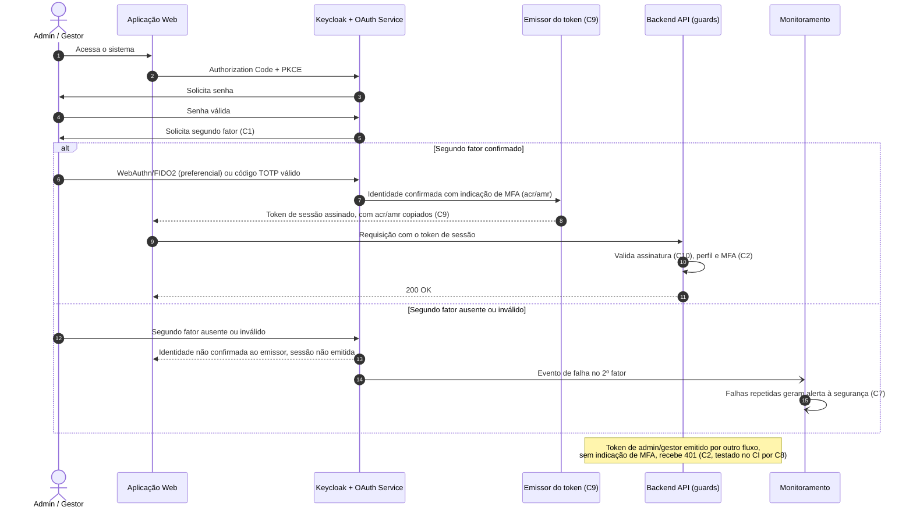
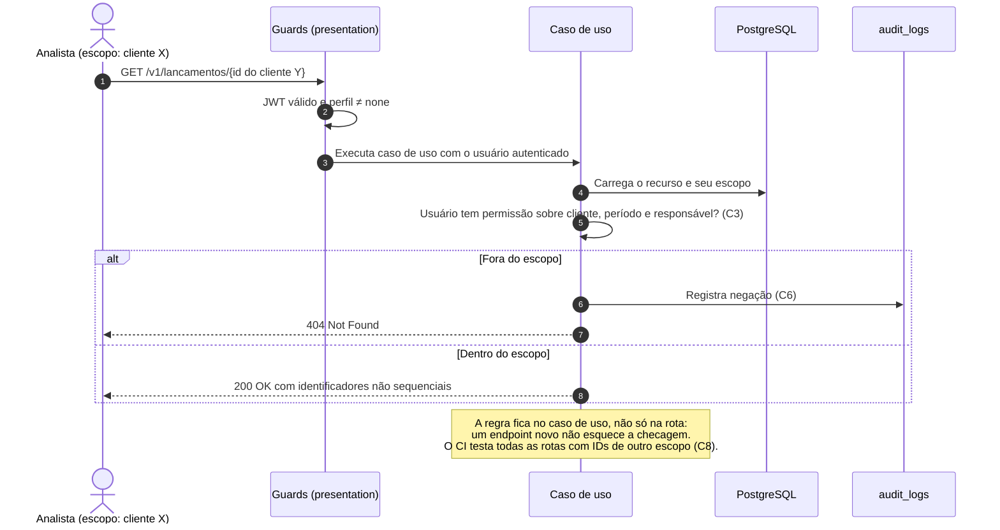
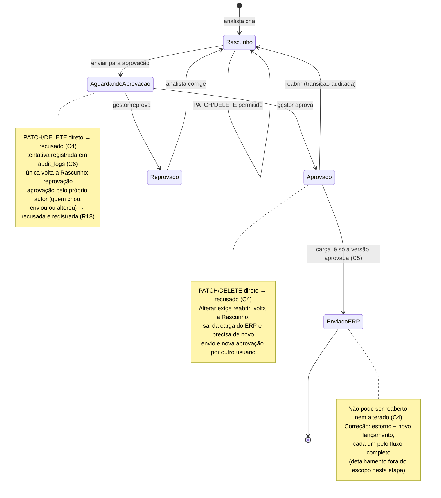
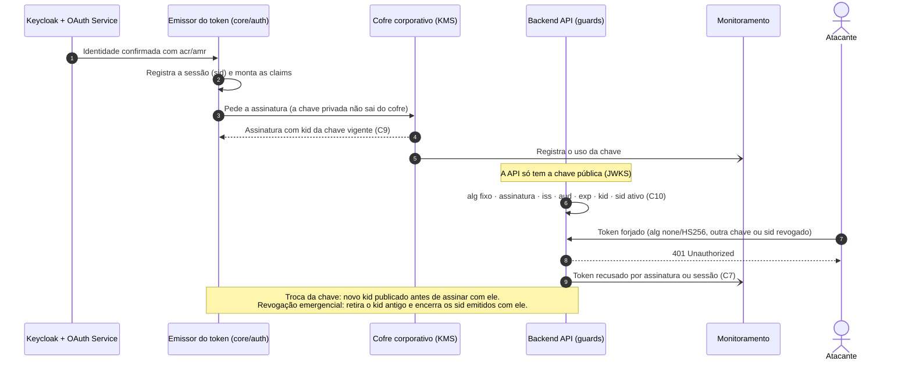
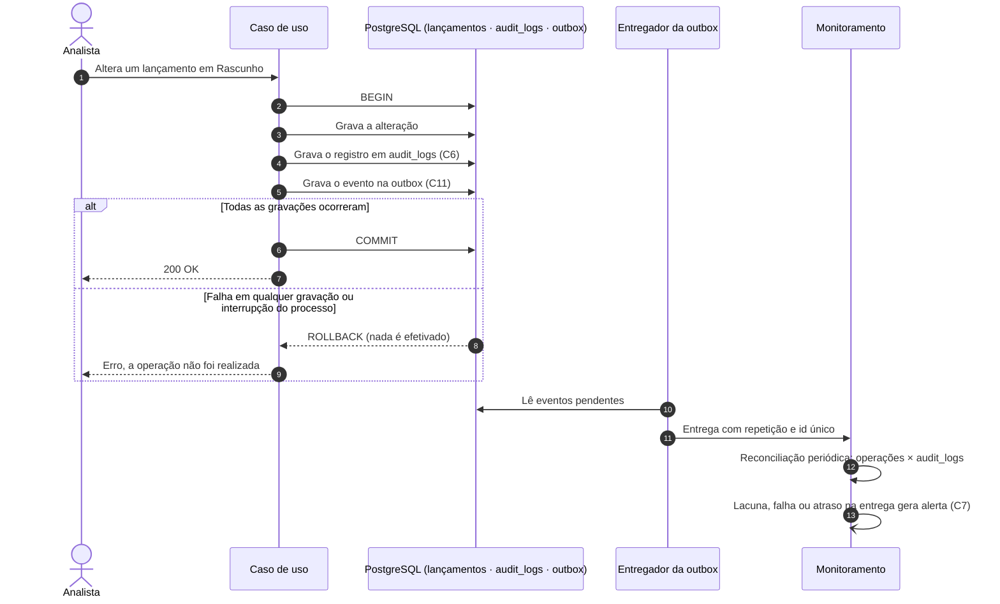
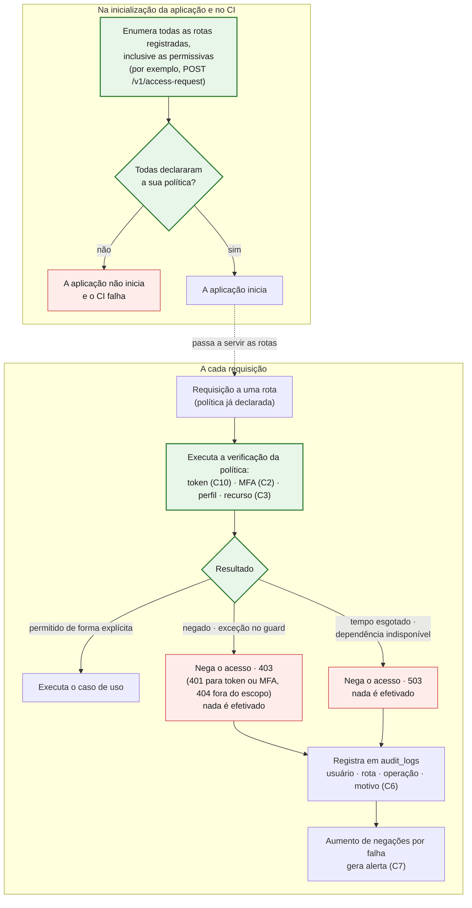
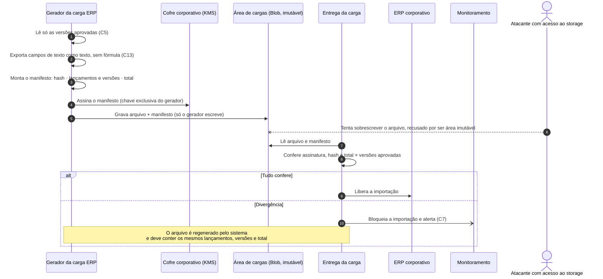
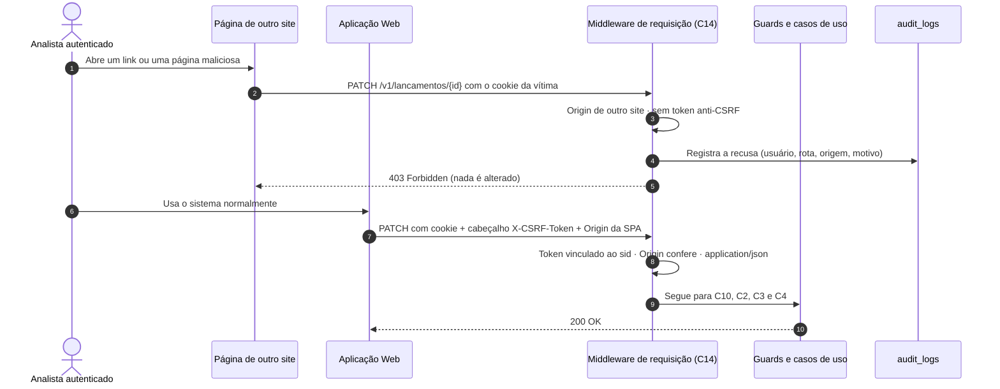

# Etapa 3 — Diagrama da arquitetura segura

Este documento mostra como usuários, aplicação, autenticação, autorização, dados e monitoramento se organizam na arquitetura proposta e **onde ficam os controles** que tratam os riscos prioritários R01, R02, R03, R06, R07, R23, R26, R28 e R29. Ele parte da [arquitetura geral da Etapa 1](../etapa-1/etapa-1-identificacao-sistema.md#diagrama-geral), das ameaças STRIDE [T01, T02, T03, T05, T07, T09, T11, T14b, T15, T16, T24, T26, T27, T30, T31 e T34](../etapa-1/etapa-1-ameacas-stride.md) e do [mapeamento NIST CSF 2.0 da Etapa 2](../etapa-2/etapa-2-nist-csf.md), e materializa os [requisitos RS01–RS08](etapa-3-requisitos.md) e as [decisões D01–D08](etapa-3-decisoes.md).

O diagrama é uma **proposta**. Os controles marcados ainda não estão implementados, e a redução de risco só se confirma com implementação, testes e evidências.

As referências cumprem papéis distintos ao longo do documento. O STRIDE classifica as ameaças (Etapa 1), o NIST CSF 2.0 organiza os controles por função e categoria (Etapa 2), e o CWE e o OWASP nomeiam as vulnerabilidades que os controles fecham ([vulnerabilidades catalogadas](etapa-3-vulnerabilidades.md)).

## 1. Visão geral da arquitetura segura

As caixas tracejadas são as **fronteiras de confiança**. Cada controle aparece com um identificador `Cn` e com o requisito e a decisão que o originam.

```mermaid
flowchart LR
    %% ---------- Fronteira 1: Consumo (não confiável) ----------
    subgraph Z1["Fronteira 1 · Consumo (não confiável)"]
        U["Usuário corporativo<br/>admin · gestor · analista · none"]
        SPA["Aplicação Web (SPA)<br/>navegador"]
    end

    %% ---------- Fronteira 2: Borda e identidade ----------
    subgraph Z2["Fronteira 2 · Borda e identidade"]
        KC["SSO · Keycloak + OAuth Service .NET<br/>OIDC + PKCE<br/><b>C1</b> MFA obrigatório p/ admin e gestor<br/>WebAuthn/FIDO2 preferencial<br/>(RS02 · D02)"]
        ISS["Emissor do token de sessão (src/core/auth)<br/><b>C9</b> assina com chave assimétrica no cofre<br/>kid · sid registrado · copia acr/amr<br/>(RS04 · D04)"]
        KMS[("Cofre corporativo · KMS<br/>chave privada não exportável<br/>cada uso registrado")]
        APIM["APIM · gateway<br/>TLS · rate limit"]
    end

    %% ---------- Fronteira 3: Aplicação ----------
    subgraph Z3["Fronteira 3 · Aplicação (Backend API · FastAPI)"]
        direction TB
        CS["presentation · middleware de requisição<br/><b>C14</b> anti-CSRF: token ligado ao sid<br/>Origin/Referer da SPA · só application/json<br/>cookies SameSite=Strict · CORS restrito<br/>(RS08 · D08)"]
        G["presentation · guards (src/core/auth)<br/><b>C10</b> só a chave pública (JWKS) · alg fixo<br/>iss · aud · exp · kid · sid ativo (RS04 · D04)<br/><b>C2</b> recusa token de admin/gestor sem MFA<br/>(RS02 · D02)<br/><b>C12</b> nega por padrão: erro = negação<br/>rota sem política não sobe (RS06 · D06)"]
        UC["application · casos de uso<br/><b>C3</b> autorização por recurso:<br/>cliente · período · responsável<br/>IDs não sequenciais (RS03 · D03)"]
        SM["domain · máquina de estados<br/>billing_status<br/><b>C4</b> única via de mudança após o envio<br/>PATCH/DELETE direto recusado (RS01 · D01)"]
        ERPGEN["Gerador da carga ERP<br/><b>C5</b> lê só a última versão aprovada<br/>(RS01 · RS07 · D01 · D07)<br/><b>C13</b> campos de texto sem fórmula<br/>manifesto assinado: hash · versões · total<br/>(RS07 · D07)"]
        VER["Entrega da carga ao ERP<br/><b>C13</b> confere assinatura, hash e total<br/>divergência bloqueia a importação<br/>(RS07 · D07)"]
        CS --> G --> UC --> SM
        UC --> ERPGEN
    end

    %% ---------- Fronteira 4: Dados ----------
    subgraph Z4["Fronteira 4 · Persistência"]
        subgraph PGDB["PostgreSQL · mesmo banco (uma transação cobre lançamento, auditoria e outbox)"]
            PG[("lançamentos e versões aprovadas<br/>regras · perfis")]
            SESS[("registro de sessões<br/>sid ativo ou revogado")]
            AUD[("audit_logs · append-only<br/><b>C6</b> usuário · recurso · operação · resultado<br/>transições e negações · hash encadeado<br/>(RS01 · RS03 · RS05 · RS06 · RS08)")]
            OUT[("outbox de eventos<br/><b>C11</b> operação + auditoria + evento<br/>na mesma transação · id único<br/>(RS05 · D05)")]
        end
        BLOB[("Blob Storage<br/>anexos via URL assinada<br/>emitida após C3")]
        ERPF[("Blob Storage · área de cargas ERP<br/>imutável · escrita só pelo gerador<br/>arquivo + manifesto")]
    end

    %% ---------- Monitoramento e verificação ----------
    subgraph Z5["Monitoramento e verificação"]
        MON["Monitoramento / alertas<br/><b>C7</b> falhas repetidas no 2º fator<br/>negações por escopo · tentativas pós-envio<br/>uso da chave fora do emissor · token forjado ou revogado<br/>falhas de guard · lacunas na reconciliação<br/>requisições de origem indevida · carga divergente"]
        SEC["Equipe de segurança"]
        CI["Pipeline CI<br/><b>C8</b> suíte de testes de autorização<br/>por rota + testes da máquina de estados<br/>token de admin/gestor sem acr/amr → 401<br/>tokens inválidos · injeção de falha nos guards<br/>falha na gravação da auditoria<br/>requisições entre origens · fórmulas e carga alterada"]
    end

    ERP["ERP corporativo<br/>(sistema externo)"]

    U --> SPA
    SPA -- "① login OIDC + PKCE" --> KC
    KC -- "② identidade com indicação de MFA (acr/amr)" --> ISS
    ISS -. "assina (sem exportar a chave)" .-> KMS
    ISS -- "③ token de sessão assinado" --> SPA
    SPA -- "④ HTTPS · token de sessão" --> APIM
    APIM -- "⑤ roteia" --> CS
    ISS -- "registra o sid" --> SESS
    G -. "chave pública (JWKS)" .-> ISS
    G -. "sid ativo?" .-> SESS
    UC -- "⑥ leitura/escrita autorizada" --> PG
    UC -- "anexos" --> BLOB
    SM -- "⑦ transição + registro na mesma transação (C11)" --> AUD
    UC -- "registra negação" --> AUD
    AUD --- OUT
    ERPGEN -- "grava arquivo + manifesto" --> ERPF
    ERPGEN -. "assina o manifesto (chave própria)" .-> KMS
    ERPF --> VER
    VER -. "confere total × versões aprovadas" .-> PG
    VER -- "⑧ carga verificada" --> ERP
    VER -. "divergência" .-> MON
    KC -. "eventos de login" .-> MON
    KMS -. "usos da chave" .-> MON
    OUT -. "eventos (entrega com repetição)" .-> MON
    MON -. "alerta" .-> SEC
    CI -. "verifica antes do deploy" .-> Z3

    classDef ctrl fill:#E8F5E9,stroke:#2E7D32,stroke-width:2px,color:#1B1B1B
    classDef ext fill:#F3F4F6,stroke:#6B7280,color:#1B1B1B
    classDef data fill:#E3F2FD,stroke:#1565C0,color:#1B1B1B
    class KC,ISS,CS,G,UC,SM,ERPGEN,VER,MON,CI ctrl
    class U,SPA,ERP,SEC,APIM ext
    class PG,SESS,AUD,OUT,BLOB,ERPF,KMS data
    style PGDB fill:#F5F9FF,stroke:#1565C0
    style Z1 stroke-dasharray: 6 4
    style Z2 stroke-dasharray: 6 4
    style Z3 stroke-dasharray: 6 4
    style Z4 stroke-dasharray: 6 4
    style Z5 stroke-dasharray: 6 4
```

**Leitura do fluxo principal:** o usuário autentica no SSO (①), que só confirma a identidade de administrador ou gestor depois do segundo fator. O emissor do token de sessão recebe essa identidade com a indicação de MFA (②) e assina o token usando a chave privada guardada no cofre, que nunca sai dele (③). A SPA chama a API pelo APIM (④ e ⑤). Antes dos guards, o middleware de requisição recusa qualquer requisição que altere dados sem o token anti-CSRF da sessão ou vinda de outra origem. Os guards conhecem só a chave pública: conferem a assinatura, o algoritmo, o emissor, a audiência, a expiração e, no registro de sessões, se a sessão continua ativa e, nos perfis privilegiados, a indicação de MFA. Qualquer erro nessa verificação resulta em negação. O caso de uso confere se o usuário tem permissão **sobre aquele registro** antes de ler ou gravar (⑥). Qualquer mudança em lançamento já enviado para aprovação passa pela máquina de estados: o lançamento aprovado é reaberto para `Rascunho`, sai da carga do ERP e precisa de novo envio e nova aprovação, feita por usuário diferente do autor. A transição, o registro em `audit_logs` e o evento para o monitoramento ficam no mesmo PostgreSQL e são gravados na mesma transação (⑦), de modo que não há operação efetivada sem registro. O gerador da carga exporta só a versão aprovada, com os campos de texto neutralizados, e grava o arquivo com um manifesto assinado em uma área imutável. A entrega confere a assinatura, o hash e o total, este contra as versões aprovadas no banco, antes de liberar a importação, e o ERP recebe apenas a carga verificada (⑧).

## 2. Controles posicionados no diagrama

| Controle | Onde fica                                                                | O que faz                                                                                                                                                                                                                                                                                                                                                                                                                 |          Requisito           |         Decisão         |                    Risco                    | Ameaça STRIDE (Etapa 1)                                                   | NIST CSF 2.0 (Etapa 2) |
| :------: | ------------------------------------------------------------------------ | ------------------------------------------------------------------------------------------------------------------------------------------------------------------------------------------------------------------------------------------------------------------------------------------------------------------------------------------------------------------------------------------------------------------------- | :--------------------------: | :---------------------: | :-----------------------------------------: | ------------------------------------------------------------------------- | ---------------------- |
|    C1    | Keycloak e OAuth Service .NET                                            | Exige o segundo fator para administrador e gestor antes de confirmar a identidade ao emissor, com WebAuthn/FIDO2 como fator preferencial                                                                                                                                                                                                                                                                                  |             RS02             |           D02           |                     R02                     | T02 — Spoofing (+ EoP)                                                    | Protect · PR.AA        |
|    C2    | Guards da API (`src/core/auth`, `presentation`)                          | Recusa token de perfil privilegiado sem a indicação de MFA concluído                                                                                                                                                                                                                                                                                                                                                      |             RS02             |           D02           |                     R02                     | T02 — Spoofing (+ EoP)                                                    | Protect · PR.AA        |
|    C3    | Casos de uso da camada `application`                                     | Verifica a permissão sobre o recurso (cliente, período, responsável) em lançamentos, anexos e consultas; IDs não sequenciais como defesa em profundidade, sem substituir essa verificação                                                                                                                                                                                                                                 |             RS03             |           D03           |                     R03                     | T03, T07, T09, T11, T26 — Info. Disclosure (+ EoP)                        | Protect · PR.AA        |
|    C4    | Máquina de estados (`billing_status`)                                    | Recusa `PATCH`/`DELETE` direto após o envio para aprovação; a mudança só ocorre depois da reprovação (em `AguardandoAprovacao`) ou da transição "reabrir" (em `Aprovado`), que devolvem o lançamento a `Rascunho` e exigem nova aprovação; recusa e registra a aprovação pelo próprio autor (quem criou, enviou ou alterou), regra de R18; não reabre lançamento em `EnviadoERP`, corrigido por estorno e novo lançamento |             RS01             |           D01           |                     R01                     | T01 — Tampering                                                           | Protect · PR.DS        |
|    C5    | Gerador da carga do ERP                                                  | Lê somente a última versão aprovada de cada lançamento; um lançamento reaberto fica fora da carga até nova aprovação; é a base da conferência do total feita por C13                                                                                                                                                                                                                                                      |          RS01, RS07          |        D01, D07         |                  R01, R23                   | T01, T31 — Tampering                                                      | Protect · PR.DS        |
|    C6    | Tabela `audit_logs`                                                      | Registra cada transição, tentativa recusada, negação por escopo, negação por falha do guard e requisição recusada por origem ou token anti-CSRF, com usuário, recurso, operação e resultado; tabela append-only, sem `UPDATE`/`DELETE` para o usuário da aplicação e com encadeamento por hash (R08)                                                                                                                      | RS01, RS03, RS05, RS06, RS08 | D01, D03, D05, D06, D08 |           R01, R03, R26, R28, R29           | T01 — Tampering; T05, T34 — Repudiation; T14b, T27 (registro das recusas) | Protect · PR.PS        |
|    C7    | Monitoramento e alertas                                                  | Alerta a equipe de segurança sobre falhas repetidas no segundo fator, negações por escopo, tentativas de alteração pós-envio, uso da chave de assinatura fora do emissor, tokens recusados por assinatura ou sessão revogada, negações por falha de guard, lacunas na reconciliação da auditoria, requisições recusadas por origem ou token anti-CSRF e cargas do ERP com divergência                                     |          RS01–RS08           |         D01–D08         | R01, R02, R03, R06, R07, R23, R26, R28, R29 | T01, T02, T03, T14b, T15, T16, T27, T30, T31, T34                         | Detect · DE.CM / DE.AE |
|    C8    | Pipeline de CI                                                           | Roda a suíte de testes de autorização por rota, os testes da máquina de estados, o teste de token de administrador ou gestor sem `acr`/`amr` (recusado com `401`), os testes de tokens inválidos, a injeção de falha nos guards e a falha simulada na gravação da auditoria, as requisições entre origens e os testes de fórmula e de carga alterada; bloqueia o deploy se falharem                                       |          RS01–RS08           |         D01–D08         | R01, R02, R03, R06, R07, R23, R26, R28, R29 | T01, T02, T03, T14b, T16, T27, T30, T31, T34                              | Protect · PR.PS        |
|    C9    | Emissor do token de sessão (`src/core/auth`) e cofre corporativo (KMS)   | Assina o token de sessão com chave assimétrica (por exemplo, ES256) cuja parte privada não sai do cofre; publica a chave pública com `kid`, permite a troca da chave sem interrupção, registra a sessão (`sid`) e copia a indicação de MFA recebida do Keycloak. Elimina o `JWT_SECRET` compartilhado                                                                                                                     |             RS04             |           D04           |                  R06, R07                   | T15 — Info. Disclosure; T16 — Spoofing                                    | Protect · PR.DS        |
|   C10    | Guards da API (`src/core/auth`, `presentation`)                          | Valida o token só com a chave pública, aceita um único algoritmo e confere `iss`, `aud`, `exp`, `kid` e se o `sid` está ativo; recusa com `401` qualquer token que falhe em uma dessas verificações                                                                                                                                                                                                                       |             RS04             |           D04           |                  R06, R07                   | T16 — Spoofing                                                            | Protect · PR.AA        |
|   C11    | Casos de uso, `audit_logs` e *outbox* de eventos                         | Grava a operação, o registro de auditoria e o evento para o monitoramento na mesma transação; se a auditoria falhar, a operação é desfeita. A *outbox* entrega os eventos com repetição e identificador único, e uma reconciliação periódica procura lacunas                                                                                                                                                              |             RS05             |           D05           |                     R26                     | T34 — Repudiation                                                         | Protect · PR.PS        |
|   C12    | Guards e política de acesso das rotas (`presentation`)                   | Nega por padrão: exceção, tempo esgotado ou dependência indisponível durante a verificação resulta em negação, sem efetivar a operação. Toda rota, inclusive as permissivas, declara a sua política, e a aplicação não inicia se alguma não tiver política. A negação responde `403` e a dependência indisponível `503`, sem detalhes internos                                                                            |             RS06             |           D06           |                     R28                     | T14b — Elevation of Privilege                                             | Protect · PR.AA        |
|   C13    | Gerador da carga do ERP, área de cargas no Blob Storage e entrega ao ERP | Exporta os campos de texto como texto, sem avaliação de fórmula; grava o arquivo com um manifesto (hash, lançamentos e versões aprovadas, total) assinado com chave do cofre exclusiva do gerador, em área imutável onde só o gerador escreve; a entrega confere assinatura, hash e total antes de liberar a importação e bloqueia quando há divergência                                                                  |             RS07             |           D07           |                     R23                     | T30, T31 — Tampering                                                      | Protect · PR.DS        |
|   C14    | Middleware de requisição (`presentation`), antes dos guards              | Exige, nas rotas que alteram dados, token anti-CSRF vinculado ao `sid` em cabeçalho próprio e `Origin`/`Referer` igual à origem da SPA; aceita só `application/json`; emite os cookies com `SameSite=Strict`, `Secure` e `HttpOnly`; CORS só para a origem da SPA                                                                                                                                                         |             RS08             |           D08           |                     R29                     | T27 — Spoofing (+ Tampering)                                              | Protect · PR.PS        |

Na coluna NIST CSF 2.0, C4 e C5 estão em PR.DS porque protegem a integridade do lançamento depois do envio para aprovação. A Etapa 2 associa R01 a PR.AA pelo mínimo privilégio na escrita, que continua valendo para o acesso de cada perfil, mas a recusa da alteração direta é proteção do dado. C6 está em PR.PS, categoria que inclui a geração de registros de log. A detecção feita sobre esses registros fica em C7. C9 está em PR.DS porque protege a chave de assinatura, como no tratamento de R06 na Etapa 2, e C10 e C12 estão em PR.AA porque decidem quem é autenticado e autorizado. C11 está em PR.PS, como C6, porque garante a geração dos registros. C13 está em PR.DS porque protege a integridade do arquivo depois de gerado. A Etapa 2 associa R23 a PR.PS pela validação dos dados exportados, que continua valendo para a neutralização de fórmulas, mas o manifesto assinado é proteção do dado. C14 segue a Etapa 2 e fica em PR.PS, porque é configuração da plataforma web (cookies, CORS e verificação de origem).

## 3. Justificativa do posicionamento dos controles

A tabela anterior mostra onde cada controle fica. Esta seção justifica por que ele fica naquele ponto da arquitetura e não em outro, e qual vulnerabilidade catalogada ele fecha.

| Controle | Vulnerabilidade tratada                                                           | Por que neste ponto da arquitetura                                                                                                                                                                                                                                                                                                                                                                                                                                                                                                                                                                                                                                                            |
| :------: | --------------------------------------------------------------------------------- | --------------------------------------------------------------------------------------------------------------------------------------------------------------------------------------------------------------------------------------------------------------------------------------------------------------------------------------------------------------------------------------------------------------------------------------------------------------------------------------------------------------------------------------------------------------------------------------------------------------------------------------------------------------------------------------------- |
|    C1    | CWE-308, OWASP A07:2025                                                           | O SSO corporativo é o único ponto de autenticação do usuário. Exigir o segundo fator ali evita reimplementar o MFA na aplicação e o aplica de forma uniforme a todo cliente do Keycloak (D02).                                                                                                                                                                                                                                                                                                                                                                                                                                                                                                |
|    C2    | CWE-308, OWASP A07:2025                                                           | O MFA no SSO não basta sozinho, porque um token emitido por outro fluxo, como o provedor `local` de desenvolvimento ou um cliente mal configurado, chegaria à API sem o segundo fator. A verificação no guard fecha esse desvio para os perfis de administrador e gestor na primeira fronteira controlada pela aplicação (D02). C2 não trata R20: a desativação do provedor `local` em produção continua sendo premissa de D04, tratada pelo plano da Etapa 2.                                                                                                                                                                                                                                |
|    C3    | CWE-639, CWE-862, OWASP A01:2025                                                  | O guard `require_role` responde ao que o perfil pode fazer, e não sobre quais registros. A checagem precisa conhecer o recurso carregado (cliente, período e responsável), e essa informação só existe no caso de uso. Colocá-la ali, e não na rota, impede que um endpoint novo a omita (D03). Os identificadores não sequenciais só dificultam adivinhar registros de outro escopo. São defesa em profundidade e não substituem a autorização por recurso, porque um identificador vazado ou observado continua válido.                                                                                                                                                                     |
|    C4    | CWE-841, OWASP A06:2025                                                           | A regra de aprovação é uma invariante de domínio. Na máquina de estados `billing_status`, ela vale para qualquer rota, tarefa Celery ou caso de uso que altere o lançamento, sem depender da interface (D01). A transição de aprovação também recusa e registra a aprovação feita por quem criou, enviou ou alterou o lançamento, regra herdada de R18.                                                                                                                                                                                                                                                                                                                                       |
|    C5    | CWE-841, OWASP A06:2025; suporte a CWE-345                                        | O ERP é o destino final do valor e fica fora da fronteira do sistema. Restringir a leitura à versão aprovada no próprio gerador da carga garante que uma alteração não aprovada nunca cruze essa fronteira, mesmo que C4 falhe (defesa em profundidade, D01). Um lançamento reaberto não tem versão aprovada vigente e, por isso, não entra na carga até ser aprovado de novo. C5 também sustenta C13: a entrega confere o total da carga com as mesmas versões aprovadas que C5 lê (RS07, D07).                                                                                                                                                                                              |
|    C6    | Suporte a CWE-841, CWE-639, CWE-778, CWE-636 e CWE-352                            | O registro é gravado no mesmo ponto em que a transição ou a negação acontece. Assim, a evidência de não repúdio (T05) e a entrada para a detecção (C7) não dependem de um componente separado que possa ser ignorado. A tabela é append-only: o usuário da aplicação só tem `INSERT`, sem `UPDATE` nem `DELETE`, e cada registro guarda o hash do anterior. Assim, quem compromete a API não apaga o próprio rastro sem quebrar o encadeamento, conforme o tratamento de R08 na Etapa 2. A garantia de que o registro é gravado vem de C11. As negações por falha do guard (RS06, D06) e as requisições recusadas pela verificação anti-CSRF (RS08, D08) ficam na mesma tabela, com o motivo. |
|    C7    | Suporte a CWE-308, CWE-639, CWE-841, CWE-522, CWE-778, CWE-636, CWE-345 e CWE-352 | Os eventos vêm de três fontes: os logins do Keycloak, os usos da chave no cofre e os eventos de `audit_logs` entregues pela *outbox* (C11). O monitoramento fica fora da aplicação para que um comprometimento da API não silencie os alertas. Ele implementa a função Detect (DE.CM e DE.AE) do plano da Etapa 2.                                                                                                                                                                                                                                                                                                                                                                            |
|    C8    | CWE-862, CWE-841, CWE-308, CWE-347, CWE-636, CWE-778, CWE-352, CWE-1236           | O CI é o último ponto antes do deploy. Testes de autorização por rota e da máquina de estados ali transformam RS01 e RS03 em critérios verificáveis e detectam regressões como o guard que falha aberto (T14b, R28). O teste de token de administrador ou gestor sem `acr`/`amr`, recusado com `401`, verifica RS02 (D02, R02). Os testes de tokens inválidos, de injeção de falha nos guards e de falha na gravação da auditoria verificam RS04, RS05 e RS06 da mesma forma. Os testes entre origens verificam RS08, e os de fórmula e de carga alterada verificam RS07.                                                                                                                     |
|    C9    | CWE-522, OWASP A04:2025                                                           | Com chave simétrica, toda instância que valida também consegue assinar, e o segredo precisa estar na memória e na configuração de cada uma. Concentrar a assinatura em um único emissor, com a chave privada não exportável no cofre, reduz a superfície de vazamento a um ponto controlado e auditado: um dump de memória, um log ou uma imagem da API não contém nada que permita forjar um token (D04).                                                                                                                                                                                                                                                                                    |
|   C10    | CWE-347, OWASP A04:2025 e A07:2025                                                | A verificação precisa ficar no guard, que é a primeira fronteira controlada pela aplicação e por onde toda requisição passa. Fixar o algoritmo impede a troca para `none` ou para `HS256` com a chave pública como segredo. O `sid` ativo permite revogar uma sessão ou todas as de uma chave sem esperar a expiração do token (D04).                                                                                                                                                                                                                                                                                                                                                         |
|   C11    | CWE-778, CWE-223, OWASP A09:2025                                                  | A auditoria só é garantida se for gravada no mesmo ponto e na mesma transação da operação. Um componente em background, depois da confirmação, pode perder o registro sem desfazer a operação. A *outbox* separa a gravação do registro, que é síncrona, da entrega ao monitoramento, que pode atrasar sem perder eventos (D05).                                                                                                                                                                                                                                                                                                                                                              |
|   C12    | CWE-636, CWE-755, OWASP A10:2025                                                  | A negação por padrão precisa ficar no mecanismo comum dos guards, e não em cada rota, para que uma exceção não prevista também resulte em negação. A exigência de política declarada na inicialização da aplicação impede que uma rota nova seja servida sem verificação, o que complementa a autorização por recurso de C3 (D06).                                                                                                                                                                                                                                                                                                                                                            |
|   C13    | CWE-345, CWE-353, CWE-1236, OWASP A08:2025                                        | C5 garante o conteúdo no momento da geração, mas o arquivo atravessa o storage antes de chegar ao ERP. A neutralização precisa ficar no gerador, que é quem conhece quais campos são texto. A assinatura também fica no gerador, o único que sabe quais versões aprovadas entraram. A verificação fica no último ponto controlado pelo sistema antes da fronteira com o ERP. A chave de assinatura é diferente da chave dos tokens de C9, para que o comprometimento de uma não alcance a outra (D07).                                                                                                                                                                                        |
|   C14    | CWE-352, OWASP A01:2025                                                           | O CSRF explora o cookie, que o navegador envia sozinho. Por isso a verificação precisa ficar antes dos guards: eles veem um token válido e não distinguem a requisição induzida da legítima. O `SameSite=Strict` não basta sozinho, porque outro sistema no mesmo domínio corporativo é considerado do mesmo site. O token vinculado ao `sid` e a conferência de `Origin` fecham esse caminho (D08).                                                                                                                                                                                                                                                                                          |

## 4. Fluxos detalhados dos riscos prioritários

### 4.1 R02 — Login de perfil privilegiado com MFA (C1, C9, C2, C7 e C8)

O fator preferencial é o WebAuthn/FIDO2 (chave de segurança ou passkey) configurado no Keycloak, porque a assinatura fica vinculada à origem e não é aceita por um site falso. O TOTP fica como alternativa, mas tem uma limitação conhecida: um proxy de phishing em tempo real pode capturar a senha e o código e reutilizá-los dentro da validade do código. Nesse caso, a defesa restante são os alertas de C7 e a detecção de sessão anômala prevista no plano da Etapa 2.

### 4.2 R03 — Autorização por recurso (C3, C6 e C8)

Para recurso fora do escopo, a API responde sempre `404 Not Found`, a mesma resposta dada a um identificador inexistente. Um `403` confirmaria que o registro existe e permitiria enumerar identificadores de outros clientes. A negação continua registrada em `audit_logs` com o motivo real (C6).

### 4.3 R01 — Máquina de estados como única via de mudança (C4, C5 e C6)

> Os nomes dos estados acima são ilustrativos. Na implementação, devem corresponder aos valores do objeto de valor `billing_status`. "Enviado", nos requisitos e nas decisões, significa enviado para aprovação (a partir de `AguardandoAprovacao`), e não `EnviadoERP`. A reabertura leva a `Rascunho`, o único estado em que `PATCH` e `DELETE` são aceitos, e não a `AguardandoAprovacao`, onde seriam recusados. Em `AguardandoAprovacao`, a única volta a `Rascunho` é a reprovação, passando por `Reprovado`; não há transição para retirar o envio. Um lançamento em `EnviadoERP` já está registrado no ERP e não é reaberto: a correção é feita por um lançamento de estorno e um novo lançamento, cada um com envio, aprovação por outro usuário e carga verificada. O desenho do estorno depende do layout do ERP e fica fora do escopo desta etapa.

### 4.4 R06 e R07 — Emissão e validação do token de sessão (C9, C10 e C7)

Com essa organização, o vazamento de um arquivo de configuração, de uma imagem ou de um dump de memória da API não entrega nada que permita assinar um token, porque a API guarda apenas a chave pública. Restam dois caminhos de ataque, o comprometimento do próprio emissor e o abuso da permissão de assinatura no cofre. Ambos ficam concentrados em um único componente, com cada uso da chave registrado e alertado (C7).

### 4.5 R26 — Auditoria gravada na mesma transação da operação (C11, C6 e C7)

O ponto central é a ordem: hoje a operação é confirmada e o registro é gravado depois, em background. Com C11, o registro faz parte da operação, e uma falha desfaz as duas. A entrega ao monitoramento continua assíncrona, mas o evento já está gravado na *outbox* e é reenviado até ser confirmado.

### 4.6 R28 — Guard que nega por padrão (C12)

A verificação da política declarada acontece antes de a aplicação servir qualquer requisição, na inicialização e no CI, e vale para todas as rotas, inclusive as permissivas. Por isso, no fluxo por requisição, toda rota já tem política. Nesse fluxo, a negação responde `403`, e a dependência indisponível ou sem resposta a tempo responde `503`, ambas sem detalhes internos no corpo, que ficam só em `audit_logs`. As respostas `401` (token inválido ou sem MFA, C10 e C2) e `404` (recurso fora do escopo, C3) continuam valendo nos seus casos.

Só um resultado explícito de permissão leva à execução. Qualquer outro caminho, inclusive um erro que o código não previu, termina em negação. Uma dependência indisponível (por exemplo, o registro de sessões) passa a tornar a API indisponível para as rotas restritas, em vez de abri-las. Essa troca de disponibilidade por integridade é intencional e está discutida em D06.

### 4.7 R23 — Carga do ERP com manifesto assinado e verificação antes da importação (C13, C5 e C7)

A verificação do total compara o manifesto com a soma das versões aprovadas no banco, e não só com o próprio arquivo. Assim, mesmo um atacante que conseguisse gravar no storage e gerar um hash novo não teria uma assinatura válida, e um arquivo regenerado por fora do sistema não bate com o que foi aprovado.

### 4.8 R29 — Requisição induzida por outro site (C14)

O nome `X-CSRF-Token` é ilustrativo. O que importa é ser um cabeçalho próprio, que uma página de outro site não consegue enviar sem passar pela política de CORS, restrita à origem da SPA. O cookie com `SameSite=Strict` já impede a maior parte dos casos vindos de outros domínios. O token e a conferência de `Origin` cobrem o que o `SameSite` não alcança, como outro sistema no mesmo domínio corporativo.

## 5. Relação com as etapas anteriores

| Visão                       | Etapa 1 (STRIDE)                                                         | Etapa 2 (NIST CSF 2.0)                                                                                        | Etapa 3 (este diagrama) |
| --------------------------- | ------------------------------------------------------------------------ | ------------------------------------------------------------------------------------------------------------- | ----------------------- |
| Autenticação                | T02 — Spoofing no login via Keycloak                                     | R02 · PR.AA (MFA) · DE.CM (falha no 2º fator) · RS.MA                                                         | C1, C2, C7, C8          |
| Autorização                 | T03, T07, T09, T11, T26 — Information Disclosure com EoP                 | R03 · PR.AA (permissão por recurso) · DE.CM (negações)                                                        | C3, C6, C7, C8          |
| Integridade do valor        | T01 — Tampering nas rotas `PATCH`/`DELETE`                               | R01 · PR.AA (mínimo privilégio) · DE.CM · RS.MA · RC.RP                                                       | C4, C5, C6, C7, C8      |
| Integridade do token        | T15 — Info. Disclosure do `JWT_SECRET`; T16 — Spoofing com token forjado | R06, R07 · PR.DS (chave no cofre) · DE.CM (uso anômalo) · RS.MA (troca da chave) · RC.RP (reverter operações) | C9, C10, C7, C8         |
| Não repúdio                 | T05, T34 — Repudiation (auditoria adulterada ou não gravada)             | R08, R26 · PR.PS (persistência durável) · DE.CM (lacunas) · RS.MI                                             | C6, C11, C7, C8         |
| Falha segura                | T14b — Elevation of Privilege por falha aberta do guard                  | R28 · PR.AA (negar em falhas) · DE.CM (exceções) · RS.MI                                                      | C12, C6, C7, C8         |
| Integridade da carga ERP    | T30 — injeção de fórmula; T31 — adulteração do arquivo no storage        | R23 · PR.PS (validação dos dados exportados) · DE.CM · RS.MA · RC.RP (regenerar o arquivo)                    | C13, C5, C7, C8         |
| Autenticidade da requisição | T27 — CSRF nas rotas autenticadas por cookie                             | R29 · PR.PS (anti-CSRF e cookies) · DE.CM (origem indevida) · RS.MI                                           | C14, C6, C7, C8         |

As funções **Respond** e **Recover** do plano (bloquear usuário, encerrar sessões, congelar o período e recompor o valor pela auditoria) são processos operacionais. Elas dependem dos registros de C6 e dos alertas de C7, mas não aparecem como componentes no diagrama.
