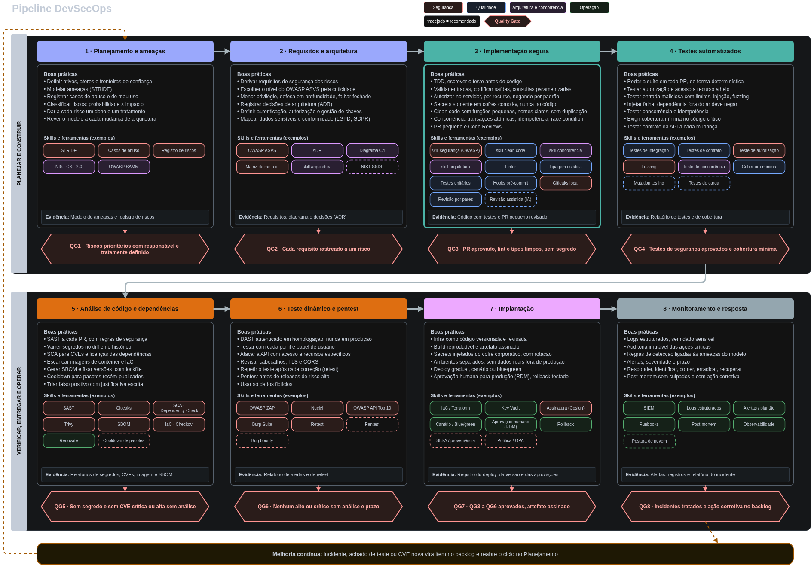

# Etapa 7 — DevSecOps

Esta etapa junta o que as [etapas 1 a 6](../../README.md#navegação-por-etapa) produziram e mostra como a segurança acompanha o ciclo de desenvolvimento, do planejamento à operação. O pipeline usa o que o sistema já tem (CI com Ruff, Mypy, Pytest, Gitleaks, Trivy e Nuclei, cooldown de dependências, Renovate, PR-Agent e as skills `sec-*`, descritas na [visão geral](../../extra/visao-geral-do-sistema.md#5-qualidade-e-entrega)) e acrescenta o que as etapas 1 a 6 definiram. O que ainda não existe aparece como proposta, em tracejado no diagrama.

> **Convenção de nomes.** Dois conjuntos de identificadores começam com "D": as **decisões de arquitetura D01 a D08** da [Etapa 3](../etapa-3/etapa-3-decisoes.md) e as **regras de detecção D01 a D14** da [Etapa 6](../etapa-6/etapa-6-regras-de-deteccao.md). Neste documento, cada citação diz a qual dos dois conjuntos se refere.

## Resultado em uma frase

O pipeline tem oito momentos, e cada um termina em um quality gate (QG1 a QG8): uma condição que bloqueia a continuação quando não é cumprida. Seis condições de bloqueio estão definidas, mais que as três exigidas.

## Diagrama do pipeline

Fonte editável: [`etapa-7-pipeline-devsecops.drawio`](../../diagramas/etapa-7-pipeline-devsecops.drawio). O modelo genérico de boas práticas que serviu de referência está em [`pipeline-devsecops-generico.drawio`](../../diagramas/pipeline-devsecops-generico.drawio) (imagem em [`pipeline-devsecops.drawio.png`](../../diagramas/pipeline-devsecops.drawio.png)); ele não descreve o projeto, só o ponto de partida.

## Visão resumida

| Momento      | Atividade de segurança        | Evidência produzida            | Condição para continuar (quality gate) |
| ------------ | ----------------------------- | ------------------------------ | -------------------------------------- |
| Planejamento | STRIDE e análise de riscos    | Tabela de ameaças e riscos     | Riscos prioritários identificados      |
| Código       | Práticas seguras e testes     | Código, pseudocódigo ou testes | Testes aprovados                       |
| Verificação  | ZAP ou ferramenta equivalente | Relatório de alertas           | Achados críticos analisados            |
| Operação     | Logs e regras de detecção     | Alertas e registros            | Incidentes tratados                    |

## Pipeline detalhado

A tabela detalha os oito momentos pedidos. A coluna Origem no projeto aponta o documento que já define a atividade. O que está marcado como _(proposta)_ ainda não existe no sistema.

| #   | Momento                          | Atividade de segurança                                                                                                      | Evidência produzida                            | Quality gate                                             | Origem no projeto                                                                                                                                        |
| --- | -------------------------------- | --------------------------------------------------------------------------------------------------------------------------- | ---------------------------------------------- | -------------------------------------------------------- | -------------------------------------------------------------------------------------------------------------------------------------------------------- |
| 1   | Planejamento e ameaças           | STRIDE, casos de abuso e análise de riscos com o NIST CSF 2.0                                                               | Tabela de ameaças e registro de riscos         | QG1: riscos prioritários identificados e com responsável | [Etapa 1](../etapa-1/etapa-1-ameacas-stride.md), [Etapa 2](../etapa-2/etapa-2-riscos-nist.md)                                                            |
| 2   | Requisitos e arquitetura         | Requisitos RS01 a RS08, decisões de arquitetura D01 a D08 e diagrama com os controles                                       | Requisitos, diagrama e decisões                | QG2: cada requisito rastreado a um risco                 | [Etapa 3](../etapa-3/etapa-3-arquitetura-segura.md)                                                                                                      |
| 3   | Implementação segura             | TDD, autorização por recurso, negar por padrão, skills de revisão, PR pequeno                                               | Código com testes e PR revisado                | QG3: PR aprovado, lint e tipos limpos, sem segredo       | [Etapa 4](../etapa-4/etapa-4-codigo-seguro.md)                                                                                                           |
| 4   | Testes automatizados             | Testes de segurança no CI: autorização por rota, MFA, máquina de estados; concorrência _(proposta)_                         | Relatório de testes e de cobertura             | QG4: todos os testes de segurança aprovados              | [Controle C8](../etapa-3/etapa-3-diagrama.md#2-controles-posicionados-no-diagrama), [protótipo corrigido](../../extra/prototipo-psp-corrigido/README.md) |
| 5   | Análise de código e dependências | Gitleaks, Trivy, cooldown de 7 dias e Renovate no CI; Dependency-Check (usado nas verificações, no CI _proposta_); SAST _(proposta)_ | Relatórios de segredos, CVEs e imagem          | QG5: sem segredo e sem CVE crítica ou alta sem análise   | [Etapa 5, retest](../etapa-5/etapa-5-retest-autenticado.md), [verificação das correções](../prototipo-corrigido/verificacao-das-correcoes.md)            |
| 6   | Teste dinâmico e pentest         | ZAP passivo e ativo autenticado (admin com MFA), Nuclei no CI e ataques à API; pentest _(proposta)_                         | Relatório de alertas do ZAP e do Nuclei        | QG6: nenhum alerta alto ou crítico sem análise           | [Etapa 5](../etapa-5/etapa-5-verificacao-vulnerabilidades.md)                                                                                            |
| 7   | Implantação                      | Deploy só com os QG3 a QG6 aprovados, segredos do cofre e aprovação humana em produção; rollback testado _(proposta)_       | Registro do deploy, da versão e das aprovações | QG7: QG3 a QG6 aprovados e produção autorizada           | [Decisões da Etapa 3](../etapa-3/etapa-3-decisoes.md)                                                                                                    |
| 8   | Monitoramento e resposta         | Logs em `audit_logs` e _outbox_, regras de detecção D01 a D14 e roteiro de resposta a incidentes; post-mortem _(proposta)_ | Alertas, registros e relatório do incidente    | QG8: incidentes tratados e lições registradas            | [Etapa 6](../etapa-6/etapa-6-deteccao-de-intrusoes.md)                                                                                                   |

## Skills e ferramentas por momento

As skills `sec-route`, `sec-oracle`, `sec-secrets` e `sec-review` e as ferramentas de CI marcadas como existentes estão no sistema, conforme a [visão geral](../../extra/visao-geral-do-sistema.md#5-qualidade-e-entrega). O ZAP e o Dependency-Check foram usados pelo grupo nas verificações da etapa 5 e do protótipo corrigido, mas não fazem parte do CI. As skills de clean code, concorrência e arquitetura **não existem ainda** e são propostas deste grupo.

| Skill ou ferramenta      | Situação                      | Momento | O que verifica                                                                                                                     |
| ------------------------ | ----------------------------- | :-----: | ---------------------------------------------------------------------------------------------------------------------------------- |
| `sec-route`              | Existente                     |    3    | Rota nova com guard, papel e escopo por recurso; guard que falha aberto (T03, T14b)                                                |
| `sec-oracle`             | Existente                     |    3    | SQL cru no Oracle sempre parametrizado (T25)                                                                                       |
| `sec-secrets`            | Existente                     |    3    | Segredo no código, na configuração e nos logs (T15, T17)                                                                           |
| `sec-review`             | Existente                     |    3    | Revisão geral contra o OWASP                                                                                                       |
| Ruff e Mypy strict       | Existente                     |  3, 4   | Estilo, erros comuns e tipagem estrita                                                                                             |
| PR-Agent                 | Existente                     |    3    | Revisão assistida do PR, em paralelo ao CI                                                                                         |
| Pytest e pytest-asyncio  | Existente                     |    4    | Suíte de testes, incluindo os testes de segurança                                                                                  |
| Gitleaks                 | Existente                     |  3, 5   | Segredo no diff e no histórico (local e no CI)                                                                                     |
| Trivy                    | Existente                     |    5    | CVEs da imagem do contêiner                                                                                                        |
| Cooldown de dependências | Existente                     |    5    | Pacote publicado há menos de 7 dias não entra (cadeia de suprimentos)                                                              |
| Renovate                 | Existente                     |    5    | Atualização de dependências por PR automático                                                                                      |
| Nuclei                   | Existente                     |    6    | Varredura dinâmica no CI                                                                                                           |
| OWASP Dependency-Check   | Usado nas verificações        |    5    | CVEs das bibliotecas do backend (SCA)                                                                                              |
| OWASP ZAP                | Usado nas verificações        |    6    | Varredura passiva e ativa autenticada                                                                                              |
| skill clean code         | Proposta                      |    3    | Funções curtas, nomes claros e ausência de duplicação, para o código ser revisável                                                 |
| skill concorrência       | Proposta                      |  3, 4   | Dupla aprovação do mesmo lançamento, transições de `billing_status` fora de ordem e reentrega de mensagens do RabbitMQ e do Celery |
| skill arquitetura        | Proposta                      |  2, 3   | Dependências entre camadas da Clean Architecture e do DDD, e aderência às decisões de arquitetura D01 a D08                        |
| SAST                     | Proposta                      |    5    | Análise estática de segurança do código Python                                                                                     |
| Pentest                  | Proposta                      |    6    | Teste manual antes de releases grandes                                                                                             |
| Rollback testado         | Proposta                      |    7    | Volta para a versão anterior sem perda de dados                                                                                    |
| Post-mortem              | Proposta                      |    8    | Lições do incidente e correção aberta no backlog                                                                                   |

## Condições que impedem a continuação do pipeline

Qualquer uma das condições abaixo **fecha o quality gate** do momento em que é detectada e para o pipeline. A equipe só libera depois de corrigir o problema ou de registrar uma análise e uma aceitação de risco assinada por quem responde pelo sistema.

| #   | Condição de bloqueio                  | Quality gate | Onde é detectada                     | Como o pipeline decide                                                                    | Exemplo no projeto                                                                                                                                                          |
| --- | ------------------------------------- | :----------: | ------------------------------------ | ----------------------------------------------------------------------------------------- | --------------------------------------------------------------------------------------------------------------------------------------------------------------------------- |
| B1  | Teste de segurança reprovado          |     QG4      | Momento 4, testes automatizados      | Um teste de autorização, MFA ou máquina de estados falha (e de concorrência, quando existir) | Teste que espera `403` e recebe `200` em uma rota de lançamentos                                                                                                            |
| B2  | Falha no controle de acesso           |  QG4 e QG6   | Momentos 4 e 6, testes e ZAP         | Um usuário sem permissão lê ou altera recurso de outro cliente, período ou responsável    | `analyst` recebe `200` em vez de `404` ao pedir regras de serviço de um cliente fora do seu escopo (R03, RS03); `admin` consegue aprovar o próprio lançamento (R18)          |
| B3  | Segredo encontrado no repositório     |  QG3 e QG5   | Momentos 3 e 5, Gitleaks             | O Gitleaks acha chave, token ou senha no diff ou no histórico                             | `JWT_SECRET` ou chave de API em arquivo versionado (T15, T17)                                                                                                               |
| B4  | Dependência conhecida como vulnerável |     QG5      | Momento 5, Dependency-Check ou Trivy | CVE de severidade crítica ou alta sem análise registrada                                  | A CVE-2025-45770 (Alta) apontada no `PyJWT` (achado V03 do [retest](../etapa-5/etapa-5-retest-autenticado.md)) bloquearia o pipeline até ser analisada; veja a nota abaixo |
| B5  | Vulnerabilidade crítica não analisada |     QG6      | Momento 6, ZAP e Nuclei              | Alerta alto ou crítico sem classificação como falso positivo e sem plano de correção      | Alerta High do ZAP sem análise                                                                                                                                              |
| B6  | Incidente aberto sem tratamento       |     QG8      | Momento 8, regras de detecção        | Alerta crítico ou alto sem triagem dentro do prazo do roteiro bloqueia novas implantações | Alerta da regra de detecção D04 ou D11 sem dono ([resposta a incidentes](../etapa-6/etapa-6-resposta-a-incidentes.md))                                                      |

Uma CVE ou um alerta que a análise classifica como **falso positivo** não bloqueia, desde que a justificativa fique registrada. Foi o que aconteceu com a CVE do exemplo B4: a [verificação das correções](../prototipo-corrigido/verificacao-das-correcoes.md#5-análise-de-dependências) mostrou que ela trata de uma biblioteca PHP, e não do `PyJWT`, e a registrou como falso positivo.

## Relação com o NIST CSF 2.0

| Momento do pipeline        | Função do CSF 2.0                          |
| -------------------------- | ------------------------------------------ |
| 1 e 2                      | Govern e Identify                          |
| 3, 4, 5 e 7                | Protect (5 também Identify, ID.RA, nas CVEs) |
| 6 e 8 (detecção)           | Detect                                     |
| 8 (resposta e recuperação) | Respond e Recover                          |
